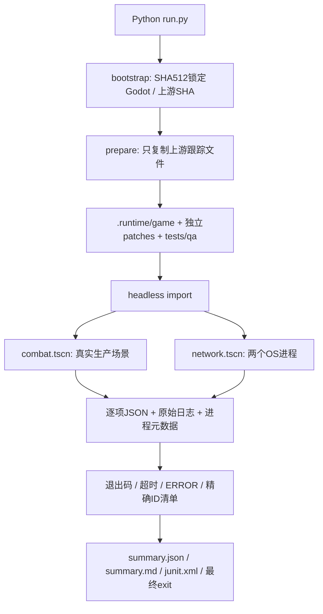

# 测试工程架构

`upstream/openfire` 是固定 commit 的子模块。`.runtime/game` 是可丢弃运行副本；`prepare.py` 校验上游 SHA 和干净状态，再恢复全部跟踪文件、移除未安装原生库的可选清单、设置专用用户目录、应用最小补丁和重建 QA 目录。旧故障注入不会留在下一次测试中。`.runtime` 不提交；不要并行执行共享运行副本的两个入口。

`combat.gd` 只负责准备、操作与断言；`fresh()` 创建 production player，`bot()` 创建 production bot；`pull()/tick()/finish()` 调用真实 trigger 与process路径。射击过程执行 `intersect_ray -> _resolve_hit -> hit -> receive_damage`，未重写游戏伤害函数，也没有修改 catalog 或倍率。头部测试把射手相机高度安排在目标中心，避免从下方先碰躯干；这是输入几何布置，不是修改伤害结果。

`network_run.py` 启动主机子进程，看到准备标志后启动客户端。进程由 `capture.py` 独立记录命令、UTC时间、平台、耗时、退出码；超时会终止整组子进程，5秒后仍不退出则强制终止。

`network.gd` 新增仅测试使用的可靠 RPC，用于**请求并上报观测快照**及驱动动作。快照在各端从生产对象读取，主机不能把期望 HP 发给客户端冒充同步结果。N04/N05 的生产 hit RPC 与 MultiplayerSynchronizer 承担实际伤害和血量同步。测试 RPC 本身不写生命值、不代替产品同步。

`run.py` 不依赖“DONE”决定成功。它核对报告结构、passed类型、计数、唯一ID全集，扫描每个真实引擎日志的 ERROR/SCRIPT ERROR，结合进程退出与超时，输出 JSON、Markdown、JUnit及最终非零退出状态。每次报告附测试/脚本/补丁 SHA256 和上游/引擎版本。

GitHub Actions 使用同一个 `run.py`，失败时仍上传证据。workflow_dispatch 的 `inject_failure=true` 在运行副本把每枪扣1发改为扣2发，**不更改断言**，预期让整个 workflow 失败；不是 continue-on-error 的假红绿演示。
